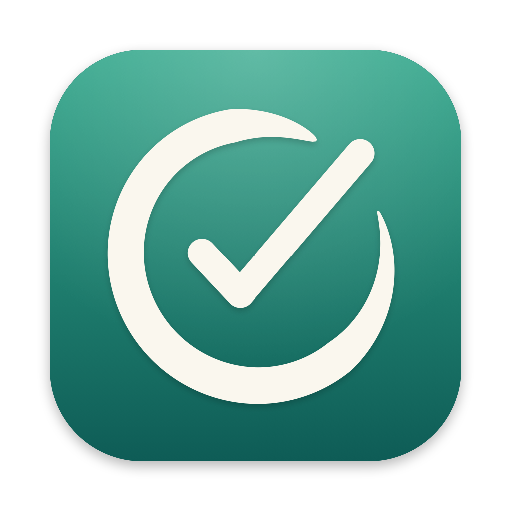

<p align="center"></p>

# ZenTask

A personal, offline-first task manager with sync: tasks, tags, priorities, lists, a calendar that
shows tasks next to Google Calendar events, habits and countdowns.

- **macOS** (SwiftUI) first; Android, Windows and Wear OS later from the same Kotlin Multiplatform core.
- **Own server** (Ktor + SQLite) for sync across devices.
- **TickTick import**: one-way sync of tasks, lists, tags, habits and countdowns.

## Build

Requires Xcode 26+, xcodegen and an arm64 JDK 17.

```bash
./gradlew :shared:allTests :server:test
scripts/build-mac.sh Release        # → build/ZenTask.app
```

Design: [`docs/superpowers/specs/2026-11-08-zentask-design.md`](docs/superpowers/specs/2026-11-08-zentask-design.md) ·
Setup: [`docs/setup-guide.md`](docs/setup-guide.md)
